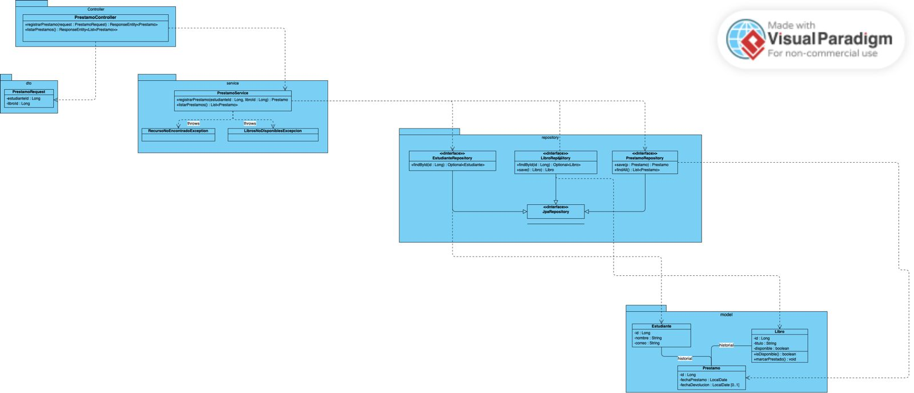
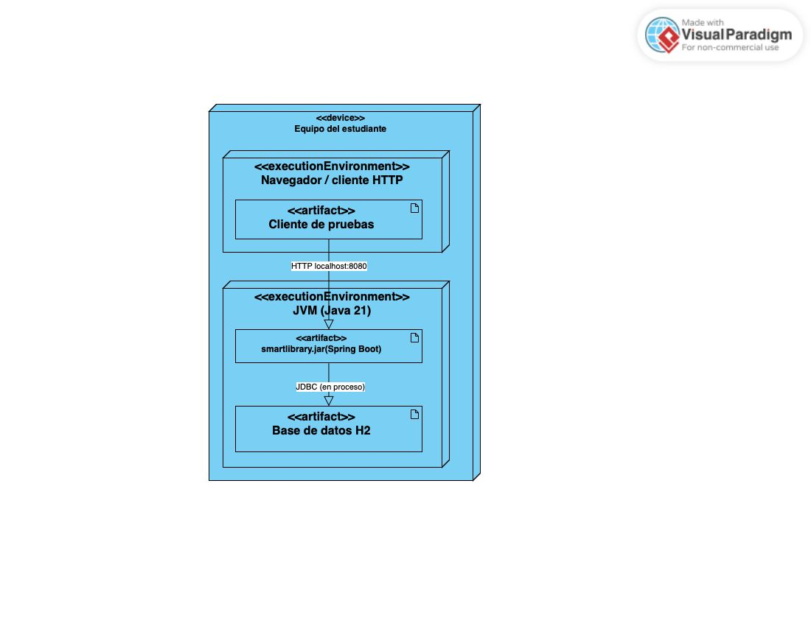

# Taller 7 - SmartLibrary

Taller práctico del bloque 7 de Diseño de Software: del modelo de clases orientado a objetos a un
diseño por tres capas para una API REST.

## Integrantes

- Samuel Santiago Hurtado Argoti
- Andrés Felipe Bolaños Cabrera

## Contenido

| Carpeta | Descripción |
|---|---|
| `smartlibrary/` | Proyecto Spring Boot (Java 21, Maven, Spring Web, Spring Data JPA, Validation, H2) |
| `diagramas/` | Diagramas del taller: imágenes y archivos fuente de Visual Paradigm (`.vpd`) |

## Diagramas

### Vista de desarrollo (clases por capas)

### Diagrama de despliegue

## Caso de estudio

SmartLibrary gestiona libros, estudiantes y préstamos. La API implementa el caso de uso
«Registrar préstamo» y la consulta de préstamos, con estas reglas:

- R1: solo un libro disponible puede prestarse.
- R2: el préstamo registra estudiante, libro y fecha.
- R3: al prestarlo, el libro deja de estar disponible.
- R4: una solicitud inválida no crea préstamo.
- R5: un libro puede tener varios préstamos históricos, pero solo uno activo a la vez.

## Estructura del proyecto

    co.edu.smartlibrary
    ├── controller   PrestamoController                   (entrada/salida HTTP)
    ├── service      PrestamoService                      (caso de uso y regla de disponibilidad)
    ├── repository   Prestamo/Libro/EstudianteRepository  (acceso a datos)
    ├── model        Estudiante, Libro, Prestamo          (entidades del dominio)
    ├── dto          PrestamoRequest, PrestamoResponse, ErrorResponse
    └── exception    excepciones 404/409 y GlobalExceptionHandler

Las dependencias van en una sola dirección: Controller → Service → Repository.

## Ejecución

Requisitos: JDK 21 y Maven.

    cd smartlibrary
    mvn test                 # ejecuta los escenarios de prueba
    mvn spring-boot:run      # arranca la API

La aplicación usa el puerto 8080; si está ocupado, toma el siguiente libre y muestra la dirección
en la consola al arrancar. La consola de H2 queda en `/h2-console`
(JDBC URL `jdbc:h2:mem:smartlibrary`, usuario `sa`, sin clave).

## Datos iniciales

| Estudiantes | Libros |
|---|---|
| 1 Ana Torres | 1 Clean Code (disponible) |
| 2 Luis Perez | 2 UML Distilled (disponible) |
| 3 Maria Gomez | 3 Design Patterns (prestado a Ana) |
| | 4 Cien años de soledad (disponible) |

## Endpoints

| Método | Ruta | Cuerpo | Respuestas |
|---|---|---|---|
| POST | `/api/prestamos` | `{"estudianteId":2,"libroId":1}` | 201, 400, 404, 409 |
| GET | `/api/prestamos` | - | 200 |

## Escenarios de prueba

| Escenario | Resultado esperado |
|---|---|
| Préstamo de libro disponible | 201 Created y préstamo registrado |
| Libro ya prestado | 409 Conflict; sin nuevo préstamo |
| Estudiante inexistente | 404 Not Found |
| Libro inexistente | 404 Not Found |
| Solicitud inválida | 400 Bad Request; sin nuevo préstamo |
| Consulta de préstamos | 200 OK con registros |

Ejemplos (en PowerShell usar `curl.exe`; ajustar el puerto si no es 8080):

    curl -i -X POST http://localhost:8080/api/prestamos -H "Content-Type: application/json" -d "{\"estudianteId\":2,\"libroId\":1}"
    curl -i -X POST http://localhost:8080/api/prestamos -H "Content-Type: application/json" -d "{\"estudianteId\":2,\"libroId\":3}"
    curl -i -X POST http://localhost:8080/api/prestamos -H "Content-Type: application/json" -d "{\"estudianteId\":999,\"libroId\":2}"
    curl -i -X POST http://localhost:8080/api/prestamos -H "Content-Type: application/json" -d "{\"estudianteId\":1,\"libroId\":999}"
    curl -i http://localhost:8080/api/prestamos
